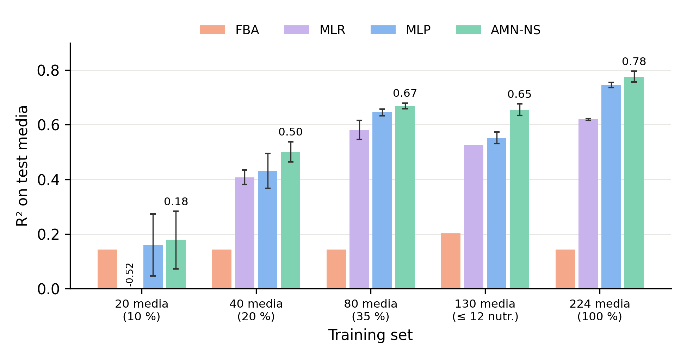

# AMN-NS: Artificial Metabolic Networks with exact mass balance

Code and results for AMN-NS, a neural-mechanistic model that predicts
growth rates from medium composition while satisfying the steady-state mass
balance SV = 0 exactly (section 5). The method applies to any organism or
strain with a genome-scale metabolic model readable by COBRApy (e.g. SBML):
it only needs the stoichiometric matrix, the flux bounds and the biomass
reaction. The repository ships one example dataset, *E. coli* growth rates
in 280 media with the GEM iML1515 [2], on which all results in section 5.2
were obtained; the penalty-based AMN of Faure et al. (2023) [1], MLP and FBA
are included as baselines.

**Dataset format.** A dataset is a GEM (`<name>.xml`) plus a CSV
(`<name>.csv`) with one column per medium compound, identified by its uptake
reaction id in the GEM, and a last column with the measured growth rate.
The first three rows describe the medium; every following row is one
experiment. Excerpt of `Dataset_input/Ecoli/iML1515EXP.csv` (51 compounds,
280 media):

| Row | `EX_co2_e_i` | … | `EX_glc__D_e_i` | `EX_xyl__D_e_i` | … | `GR_AVG` |
|---|---|---|---|---|---|---|
| 1. header: uptake reaction ids | | | | | | growth column |
| 2. level | 1 | … | 100 | 100 | … | −1 |
| 3. uptake bound when present | 6.5 | … | 6.5 | 6.5 | … | −1 |
| 4. medium 1 | 1 | … | 1 | 0 | … | 0.488 |
| 5. medium 2 | 1 | … | 1 | 0 | … | 1.046 |

- **Row 2, level:** 1 = minimal-medium compound, present in every medium
  (here 23 compounds, including O₂ and NH₄⁺); > 1 = variable compound, which
  is an input of the model (here 28 nutrients: glucose, xylose, succinate,
  20 amino acids, 4 nucleobases and thymidine); 0 = gene knockout.
  Medium 1 above is the minimal medium with glucose only; medium 2 adds the
  20 amino acids, the nucleobases and thymidine (not shown). The −1 under the growth column is a
  placeholder.
- **Row 3, uptake bound** (mmol gDW⁻¹ h⁻¹) when the compound is present.
  AMN-NS uses it for the minimal-medium compounds; the bounds of the
  variable compounds and of O₂ are options of the scripts (`--uptake`,
  `--o2`).
- **Rows 4+:** one medium per row; 1 = compound present, 0 = absent.
- **`GR_AVG`, last column:** the experimentally measured growth rate
  (h⁻¹; 0.07 to 1.05 here), averaged over the replicate experiments when a
  medium was measured more than once. It is the target the models are
  trained on and evaluated against.

The scripts read the training set as `<name>.npz` (built from the CSV and
the GEM) and the GEM as `<name>.xml`; pass `--trainingfile <path/name>`
(default: the *E. coli* example).

## Table of Contents
- [1. Repository structure](#1-repository-structure)
- [2. Installation](#2-installation)
- [3. Usage](#3-usage)
- [4. Citation](#4-citation)
- [5. AMN-NS: AMN with exact mass balance](#5-amn-ns-amn-with-exact-mass-balance)

## 1. Repository structure

```text
.
├── Dataset_input/Ecoli         example dataset (E. coli): 280 media x 28 nutrients
│   ├── iML1515EXP.csv          raw data (rows 2-3: medium levels and bounds)
│   ├── iML1515EXP.npz          training set (X, Y, S, Pin, Pout, medium)
│   └── iML1515EXP.xml          GEM iML1515 (irreversible, SBML)
├── Library                     data loading and the penalty-based AMN (AMN_QP)
├── amn_nullspace.py            AMN-NS and baselines (MLP, AMN_QP, FBA)
├── fba_lambda.py               FBA baseline with the published lambda protocol
├── ablation_sv.py              AMN_QP with constraint-loss weight lambda
├── learning_curve_unified.py   MLR, MLP, AMN_QP learning curves
├── plot_r2_summary.py          summary table and bar chart of section 5.2
├── results
│   ├── nullspace               first AMN-NS comparison (single seed, earlier version)
│   ├── optim                   multi-seed and nested-tuning runs (random CV)
│   ├── extrap                  simple-to-complex and low-data splits
│   ├── tune                    nested tuning of beta, uptake bound and epochs
│   ├── summary                 R² summary table (CSV) and bar chart (PNG)
│   ├── fba_lambda              FBA growth for every lambda and medium
│   ├── ablation                lambda ablation
│   └── learning_curve          learning-curve logs
├── README.md
└── requirements.yml
```

## 2. Installation

```bash
conda env create -f requirements.yml
conda activate amn_ns
```

Tested with Python 3.10.6, TensorFlow 2.15, COBRApy 0.29, scikit-learn 1.6
on macOS (CPU). The code hides the GPU: with tensorflow-metal 1.2.0 on Apple
GPUs, compiled Keras models silently drop the activation between dense
layers, so results would be wrong.

## 3. Usage

See [5.3 Usage](#53-usage). Every script runs from the repository root.

## 4. Citation

The AMN framework: Faure L, Mollet B, Liebermeister W, Faulon J-L.
*Nat Commun* 14, 4669 (2023).

## 5. AMN-NS: AMN with exact mass balance

### 5.1 Summary

Artificial Metabolic Networks (AMNs) couple a neural network that maps
medium composition to a flux distribution with a mechanistic layer derived
from a genome-scale metabolic model (GEM) [1]. In the penalty-based AMN
implemented here (`AMN_QP` in `Library/Build_Model.py`), the steady-state
condition SV = 0 and the uptake bounds enter only as loss terms. Trained
models did not satisfy mass balance (‖SV‖/‖V‖ ≈ 1–2 on test media), and
removing the constraint terms from the loss left growth-rate prediction
unchanged (ablation, `ablation_sv.py`). We therefore introduce **AMN-NS**, in
which mass balance holds exactly by construction and flux bounds are imposed
by a differentiable projection layer.

*Constraint set.* AMN-NS takes any genome-scale metabolic model (GEM)
readable by COBRApy [5], with reversible reactions split into forward and
backward irreversible reactions, so that the feasible fluxes for a medium x
are F(x) = { V : SV = 0, lb ≤ V ≤ ub(x) }, as in flux balance analysis
(FBA) [3]. The uptake of each variable medium component j is bounded by
u·x_j (x_j ∈ {0,1}), O₂ uptake by u_O₂, the other minimal-medium components
by the value given in the dataset (CSV row 3), and the uptake of every compound absent from the medium is
set to 0. All other bounds, such as the ATP maintenance lower bound, are
those of the GEM. Reactions that cannot carry flux even when all medium
components are available (flux variability analysis [4]) are removed. For
the example GEM, *E. coli* iML1515 [2] (minimal-medium bound 6.5, ATP
maintenance ≥ 6.86 mmol gDW⁻¹ h⁻¹), this leaves 2,712 reactions and 1,595
metabolites.

*Architecture: what is learned and what is fixed.* AMN-NS has two parts.

1. **Neural layer (learned).** A dense network maps the medium x to
   coordinates in the null space of S, and hence to an initial flux vector
   that is already at steady state:
   V⁰ = N (W₂ (W₁ x + b₁) + b₂), with 1,000 hidden units, no activation
   function and dropout 0.25 on the hidden layer.
   **N** is a fixed matrix (reactions × null-space dimension) whose columns
   are an orthonormal basis of the null space of the stoichiometric matrix
   S, i.e. SN = 0 and NᵀN = I. It is computed once, before training, from
   the singular value decomposition of S: its columns are the right
   singular vectors of S whose singular values are zero, up to numerical
   tolerance (`scipy.linalg.null_space`). For iML1515, N is 2,712 × 1,330.
   Any vector Nc satisfies S(Nc) = 0, so the network only has to output the
   coordinates c = W₂ (W₁ x + b₁) + b₂ of V⁰ in this basis.
   V⁰ is therefore an affine function of the medium: all the nonlinearity of the growth response comes
   from the mechanistic layer (the hidden layer over-parametrises the affine
   map, and dropout regularises it). The weights W₁ (1,000 × number of medium
   components), b₁, W₂ (null-space dimension × 1,000) and b₂ are the **only
   trainable parameters** of AMN-NS (≈ 1.4 million for iML1515: 28 medium
   components, null-space dimension 1,330).
2. **Mechanistic layer (fixed, no trainable parameters).** It turns V⁰ into
   a flux vector V that satisfies the GEM constraints, while staying as
   close as possible to V⁰. It uses two fixed operations:
   - **NNᵀ, the mass-balance projector.** With N as above, NNᵀ is a fixed
     square matrix (reactions × reactions): for any flux vector V, NNᵀV is
     the closest flux vector that is at steady state, S(NNᵀV) = 0 exactly [6].
   - **clip, the bound operator.** clip(V, lb, ub(x)) sets every flux below
     its lower bound to lb and every flux above its upper bound to ub(x).
     Because ub(x) depends on the medium, this is where nutrient
     availability acts mechanistically.

   Applying NNᵀ and then clip once is not enough: clipping breaks mass
   balance, and projecting breaks the bounds. The two are therefore
   alternated K times with Dykstra's algorithm [7], which converges to the
   point of F(x) closest to V⁰ instead of an arbitrary feasible point:

       V_0 = V⁰,   q_0 = 0
       for k = 0 … K−1:
           z_k     = NNᵀ V_k                        (enforce SV = 0)
           V_{k+1} = clip(z_k + q_k, lb, ub(x))     (enforce bounds)
           q_{k+1} = z_k + q_k − V_{k+1}            (what the clip removed)
       V = NNᵀ V_K

   q is a bookkeeping vector, not a parameter: it stores how much the clip
   steps have cut so far and adds it back before the next clip. Without it,
   alternating projections would also reach a feasible point, but not
   necessarily the one closest to V⁰ (the NNᵀ step needs no such term because
   the null space is a linear subspace). The final multiplication by NNᵀ makes
   SV = 0 hold to machine precision (max |SV| ≈ 10⁻¹³). After K = 20 steps
   the bounds hold only approximately, with residual violation
   r = ‖clip(V, lb, ub(x)) − V‖.

The predicted growth rate is the biomass flux, $\hat{\mu} = P_{out} V$,
where the row vector $P_{out}$ selects the biomass reaction. The mechanistic layer
contains only matrix products and clips, so gradients pass through it, and
training adjusts W₁, b₁, W₂, b₂ so that the *constrained* flux vector
predicts growth. The equality constraints are satisfied by construction
(reparametrisation), in the spirit of hard-constrained neural
networks [8,9]. The loss, for a measured growth rate μ, is

```math
L = (\hat{\mu} - \mu)^2 + \beta\, r^2
```

where β weights the remaining bound violation.

*Training.* Adam [10], learning rate 10⁻³ halved when the training loss
plateaus (patience 10 epochs), batch size 10, 100 epochs, β = 0.1, K = 20,
no weight decay on W₂. The uptake bounds u and u_O₂ must make every
measured growth rate feasible. For the *E. coli* dataset, u = 10 and
u_O₂ = 20 do; with u_O₂ = 6.5, 165 of the 280 measured rates exceed the FBA
maximum.

### 5.2 Results (*E. coli*, 280 media, iML1515)

R² is collated: one R² over all test predictions of a run. Values are
mean ± sd over training seeds (3 seeds; 5 for AMN-NS on the
simple-to-complex split). Baselines: MLR (multiple linear regression, ordinary least
squares on the presence vector), MLP (1 hidden layer of 1,000 ReLU units,
scikit-learn) and FBA. AMN-NS uses fixed settings
(β = 0.1, u = 10, 100 epochs); tuning them does not help (see *Tuning* below).

**Random 5-fold CV** (interpolation: test media resemble training media).

| Model | R² | Ensemble |
|---|---|---|
| FBA, published protocol [1] (uptake bound λ for every compound present, best λ = 6.5) | 0.144 | – |
| MLR | 0.618 | – |
| MLP | 0.746 ± 0.009 | 0.785 |
| **AMN-NS** | **0.776 ± 0.020** | **0.797** |

*Ensemble:* the models trained with the 3 seeds are combined by averaging
their predictions for each test medium, and R² is computed on these
averaged predictions. Averaging cancels part of the seed-to-seed variation,
so the ensemble scores higher than the individual seeds. FBA and linear
regression are deterministic and have no ensemble.

FBA alone has a Pearson correlation of only 0.52 with the measured growth
rates for every λ: scaling λ rescales the predictions without changing how
media are ranked. Choosing λ on the training folds only gives the same
λ = 6.5 and R² = 0.144.

**Simple-to-complex split** (extrapolation). Training media contain at most
t of the 28 variable nutrients; the test set is every richer medium, so no
test medium resembles a training medium in size.

| Training media (t) | n train / test | MLR | MLP | **AMN-NS** |
|---|---|---|---|---|
| ≤ 10 nutrients | 75 / 205 | **0.545** | 0.429 ± 0.160 | 0.409 ± 0.086 |
| ≤ 12 nutrients | 130 / 150 | 0.526 | 0.552 ± 0.021 | **0.655 ± 0.021** |
| ≤ 14 nutrients | 164 / 116 | 0.547 | 0.614 ± 0.029 | **0.645 ± 0.055** |

**Low-data learning curve.** Same test folds as the random split, with only
n media drawn from each training fold (AMN-NS epochs scaled so that every n
gets the same number of gradient steps).

| n training media | MLR | MLP | **AMN-NS** |
|---|---|---|---|
| 20 | −0.525 ± 0.609 | 0.160 ± 0.114 | **0.178 ± 0.105** |
| 40 | 0.408 ± 0.026 | 0.431 ± 0.064 | **0.501 ± 0.037** |
| 80 | 0.581 ± 0.035 | 0.645 ± 0.013 | **0.669 ± 0.010** |

AMN-NS is the best model on interpolation, when extrapolating to richer
media (with ≥ 130 training media) and when data are scarce (≥ 40 media).
MLR alone does not extrapolate as well, so the gain comes from the mechanistic layer: the network only
proposes a flux vector that is affine in the medium, and the
stoichiometry and medium-dependent bounds produce the nonlinear growth
response.

Summary of the three tests (`plot_r2_summary.py`; error bars: sd over
seeds; FBA has no training and no seed, and MLR has no seed
dependence on the complex split; the negative R² of MLR with
20 media, fewer media than inputs, is written at the baseline):



*Tuning.* Nested selection inside each training fold (`--tune`; grid
β ∈ {0.03, 0.1, 0.3} × u ∈ {5, 6.5, 10} × {100, 200} epochs, seed 1,
`results/tune/run.sh`) gives, against the fixed settings with the same seed:

| Split | Fixed settings | Tuned | Settings chosen |
|---|---|---|---|
| Random 5-fold CV | 0.775 | 0.797 | β = 0.03 in 3 of 5 folds; u = 10 in 3, u = 5 in 2 |
| ≤ 10 nutrients | 0.537 | 0.381 | β = 0.03, u = 10, 200 epochs |
| ≤ 12 nutrients | 0.661 | 0.558 | β = 0.03, u = 6.5, 200 epochs |
| ≤ 14 nutrients | 0.686 | 0.600 | β = 0.03, u = 10, 100 epochs |

The gain on random CV is within the seed-to-seed spread, and the settings
that validate best on media similar to the training media extrapolate worse
to richer media. No uptake bound is consistently preferred, so u = 10 is
kept for every compound.

*Feasibility.* SV = 0 holds to machine precision. The residual bound
violation r after K = 20 steps is about 0.2 (mmol gDW⁻¹ h⁻¹, norm over
2,712 fluxes). Running more projection steps at prediction time lowers r
(K = 500: r ≈ 0.11) but also lowers R² (by 0.04–0.10), and tuning favours a
small β (0.03): enforcing the bounds more tightly costs accuracy, which
suggests that the bounds (u = 10, u_O₂ = 20) are only approximately
compatible with the measured growth rates.

### 5.3 Usage

All scripts run from the repository root in the `amn_ns` environment
(section 2).

```bash
# AMN-NS with random 5-fold CV (--seed sets folds and initialisation)
python amn_nullspace.py --model ns --split random --tag ns_random --plateau --epochs 100
# simple-to-complex split and low-data curve
python amn_nullspace.py --model ns --split complex --tag ns_complex --plateau --epochs 100
python amn_nullspace.py --model ns --split lowdata --tag ns_lowdata --plateau --epochs 100
# nested tuning inside each training fold
python amn_nullspace.py --model ns --split random --tag ns_tune --plateau --tune \
    --betas 0.03 0.1 0.3 --uptakes 5 6.5 10 --epochs-grid 100 200
# baselines on the same splits: --model mlp | fba
python amn_nullspace.py --model mlp --split random --tag mlp_random
# FBA with the published protocol (uptake bound lambda for every compound present)
python fba_lambda.py
# summary table and bar chart (FBA, MLR, MLP, AMN-NS)
python plot_r2_summary.py
# another organism or dataset (GEM <path/name>.xml + training set <path/name>.npz)
python amn_nullspace.py --model ns --split random --tag my_ns --plateau --epochs 100 \
    --trainingfile <path/name> --o2-id <O2 uptake id> \
    --uptake-prefix EX_ --uptake-suffix _i
```

Predictions are appended per fold to `results/nullspace/pred_<tag>.csv`
(columns: fold, medium index, measured and predicted growth, bound
violation), so an interrupted run resumes where it stopped. The reduced
model and the FBA growth rates are cached in `results/nullspace/`.

| Script | Purpose |
|---|---|
| `learning_curve_unified.py` | MLR, MLP and AMN learning curves (10–100 % of training data) on identical folds |
| `ablation_sv.py` | AMN with constraint-loss weight λ ∈ {0, 1, 100, 1000}; reports R² and ‖SV‖ |
| `amn_nullspace.py` | AMN-NS and baselines (MLP, FBA): random 5-fold CV, simple-to-complex and low-data splits, nested tuning (`--tune`) |
| `fba_lambda.py` | FBA baseline of [1]: scan of the uptake bound λ, best and cross-validated R² |
| `plot_r2_summary.py` | R² of FBA, MLR, MLP and AMN-NS on the learning curve, the ≤ 12-nutrient complex split and random CV: `results/summary/r2_summary.csv` and `r2_summary.png` |

### 5.4 References

1. Faure L, Mollet B, Liebermeister W, Faulon J-L. A neural-mechanistic
   hybrid approach improving the predictive power of genome-scale metabolic
   models. *Nat Commun* 14, 4669 (2023). doi:10.1038/s41467-023-40380-0
2. Monk JM, Lloyd CJ, Brunk E, et al. iML1515, a knowledgebase that
   computes *Escherichia coli* traits. *Nat Biotechnol* 35, 904–908 (2017).
   doi:10.1038/nbt.3956
3. Orth JD, Thiele I, Palsson BØ. What is flux balance analysis?
   *Nat Biotechnol* 28, 245–248 (2010). doi:10.1038/nbt.1614
4. Mahadevan R, Schilling CH. The effects of alternate optimal solutions in
   constraint-based genome-scale metabolic models. *Metab Eng* 5, 264–276
   (2003). doi:10.1016/j.ymben.2003.09.002
5. Ebrahim A, Lerman JA, Palsson BØ, Hyduke DR. COBRApy: COnstraints-Based
   Reconstruction and Analysis for Python. *BMC Syst Biol* 7, 74 (2013).
   doi:10.1186/1752-0509-7-74
6. Palsson BØ. *Systems Biology: Constraint-based Reconstruction and
   Analysis.* Cambridge University Press (2015).
7. Boyle JP, Dykstra RL. A method for finding projections onto the
   intersection of convex sets in Hilbert spaces. In *Advances in Order
   Restricted Statistical Inference*, Lecture Notes in Statistics 37,
   28–47. Springer (1986). doi:10.1007/978-1-4613-9940-7_3
8. Amos B, Kolter JZ. OptNet: differentiable optimization as a layer in
   neural networks. *ICML* (2017). arXiv:1703.00443
9. Donti PL, Rolnick D, Kolter JZ. DC3: a learning method for optimization
   with hard constraints. *ICLR* (2021). arXiv:2104.12225
10. Kingma DP, Ba J. Adam: a method for stochastic optimization. *ICLR*
    (2015). arXiv:1412.6980
